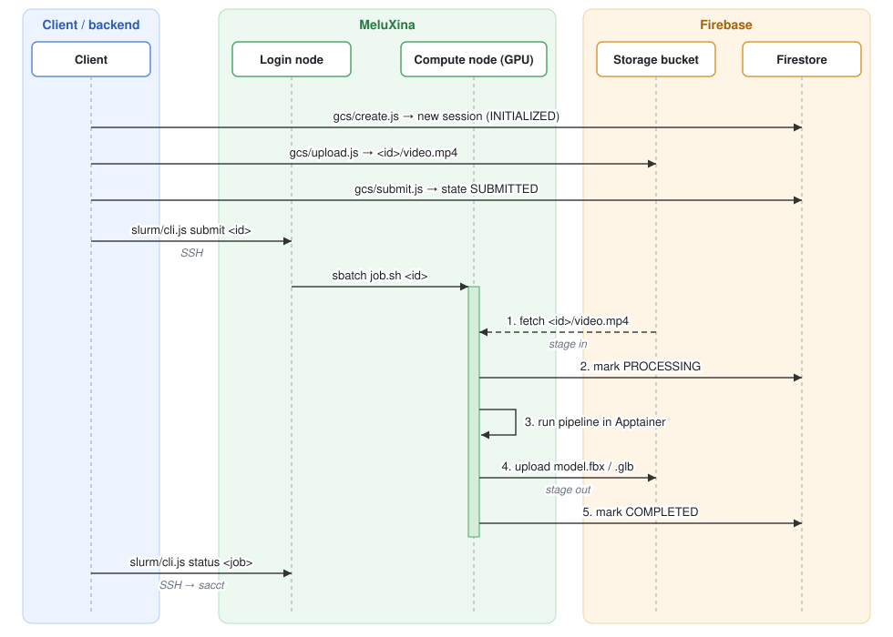

# HPC job submission with cloud storage staging

Small utilities that show how an external service can run GPU jobs on the
**MeluXina** supercomputer through **Slurm**, with **Firebase / Google Cloud Storage**
as the exchange point for input and output files.

The idea: the compute node never receives files directly from the client. Inputs are
first put in the bucket, the job **stages them onto the node** when it starts, does the
work locally, and then **uploads the results back** to the bucket. A Firestore document
per session tracks the progress, so the client can follow it without access to the cluster.

## How it fits together



## Project structure

| Folder | Runs on | What it does |
|---|---|---|
| [`slurm/`](slurm/README.md) | client machine | Node.js library and CLI that submit the job over SSH (`sbatch`) and check its state (`sacct`). |
| [`sbatch/`](sbatch/README.md) | MeluXina compute node | `job.sh`, the Slurm batch script: stages the input onto the node, runs the containerised pipeline on a GPU, uploads the results and updates the session state. |
| [`gcs/`](gcs/README.md) | client machine **and** the cluster | Node.js tools for the bucket and the Firestore sessions: create/submit sessions, list, upload and fetch files, set the session state. `job.sh` calls them on the node. |

## Quick start

1. **Cluster:** copy `gcs/` and `sbatch/job.sh` into your project folder on MeluXina, put the
   service account key next to the `gcs/` tools, and set the variables listed in
   [`sbatch/README.md`](sbatch/README.md).
2. **Client:** install and configure [`gcs/`](gcs/README.md) and [`slurm/`](slurm/README.md).
3. Run a session end to end:
   ```bash
   cd gcs
   ID=$(node create.js "My model") && node upload.js video.mp4 "$ID" && node submit.js "$ID"
   cd ../slurm
   JOB=$(node cli.js submit "$ID") && node cli.js status "$JOB"
   ```
   Once the job is COMPLETED, the results are in the bucket at `<id>/model.fbx` and `<id>/model.glb`.

## Requirements

- Node.js 18+ on the client. On the cluster, `job.sh` loads Node.js and Apptainer as modules.
- A MeluXina account and project, with SSH key access to the login nodes.
- A Firebase project with Storage and Firestore, and a service account key for it.
- Outbound HTTPS from the compute nodes to Google Cloud.

## Security

Keys, `.env` files and real ids are never committed. Every site- or project-specific value
comes from environment variables. See the per-folder READMEs for the list.
